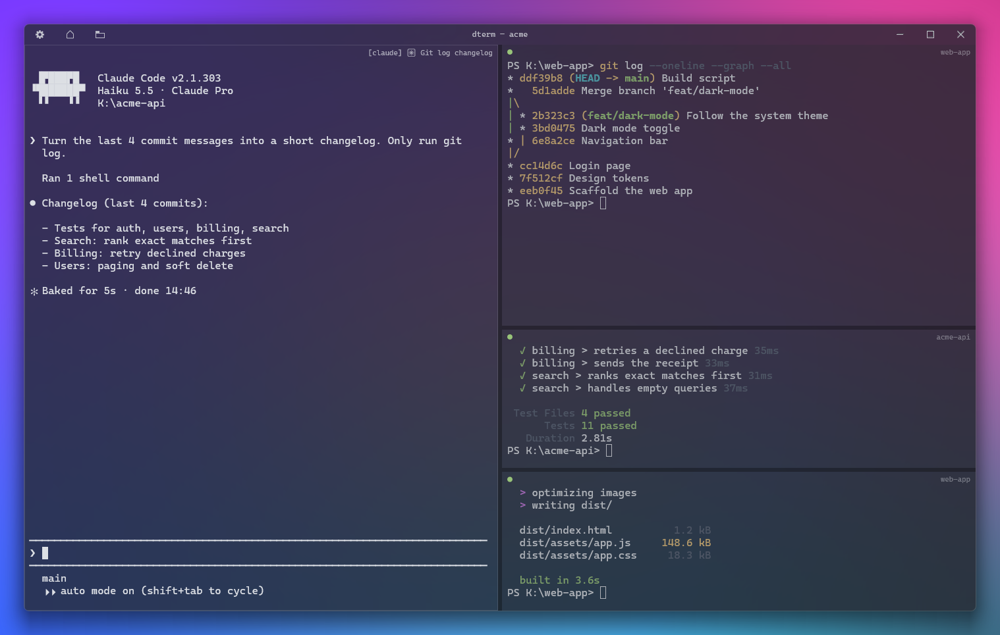

<p align="center"></p>

<h1 align="center">dterm</h1>

<p align="center">A tiny Windows terminal that puts your shells in a grid.</p>



One native exe (about 470 KB), nothing to configure. Panes run Git Bash and look like Windows
Terminal: acrylic background (kept when the window isn't focused), One Half Dark colors,
Cascadia Mono, font fallback for symbols and emoji. Each pane shows a faint name, and sessions
come back: close dterm and it offers to reopen the same panes in the same folders.

## Shortcuts

dterm's own shortcuts use Ctrl+Alt, so Ctrl+Shift combinations reach your shell and apps.
The ones marked * can be changed on the settings page. AltGr counts as Ctrl+Alt on many
keyboards; when AltGr+key types a character on your layout (like AltGr+è = `[` on an Italian
keyboard), that character wins, and left Ctrl + left Alt give the shortcut.

| Keys | Action |
| --- | --- |
| Ctrl+Alt+T * | Add a pane (splits the largest one, so the grid builds itself) |
| Ctrl+Alt+Plus / Ctrl+Alt+Minus *, Alt+Shift+Plus / Minus | Split the focused pane to the right / below |
| Ctrl+Alt+W *, or `exit` | Close the pane |
| Ctrl+Alt+R * | Rename the focused pane |
| Ctrl+Alt+Z * | Zoom the focused pane to the whole window, and back |
| Ctrl+Alt+G * | Switch between grid and tabs (also the button in the top-right corner) |
| Ctrl+Alt+S * | Save the session under a name |
| Ctrl+Alt+H * | Go to the start page (also the ≡ button); the session keeps running |
| Ctrl+Alt+Comma * | Settings |
| Alt+Arrow keys | Move focus to the pane in that direction |
| Alt+Shift+Arrow keys | Resize the focused pane |
| Ctrl+Alt+Arrow keys | Swap the focused pane with its neighbor |
| Drag a gap between panes | Resize panes |
| Ctrl+Tab / Ctrl+Shift+Tab | Next / previous pane or tab |
| Mouse drag, double / triple click, Shift+Arrow keys | Select text; Ctrl+Shift+Left / Right select by word |
| Ctrl+C (with a selection), right-click | Copy; right-click without a selection pastes |
| Ctrl+V / Ctrl+Shift+V | Paste as plain text |
| Mouse wheel | Scroll back through history |
| Ctrl+Plus / Ctrl+Minus / Ctrl+0, Ctrl+wheel | Font size |

## Sessions

Closing the window saves the session (layout, each pane's folder and name, view, font size) to
`%APPDATA%\dterm\last.session`; Ctrl+Alt+S saves it under a name in `%APPDATA%\dterm\sessions`.
When something is saved, dterm starts on a small landing page: pick the last session, a saved
one (with a preview of its layout and when it was started and closed), or a new one.
Ctrl+Alt+H brings the landing page back while you work: the running session stays first in the
list (Esc returns to it), and opening another one closes it after asking once.

Panes that run [Claude Code](https://claude.com/claude-code) come back inside it: dterm saves
each one's newest conversation and restores it with `claude --resume <id>`.

## Settings

Ctrl+Alt+Comma opens a page in the same style as the landing page: theme (One Half Dark,
Campbell, Catppuccin Mocha, Dracula), background opacity, and every dterm shortcut (Enter, then
press the new keys; Del puts back the default). Changes apply at once and are saved to
`%APPDATA%\dterm\settings`, a small text file you can also edit by hand.

## Install

Download `dterm-vX.Y.Z.exe` (or the zip) from [Releases](https://github.com/Betadeimos/dterm/releases)
and run it. There is no installer: put the exe wherever you like and pin it to the taskbar.

## Requirements

- Windows 10 1809 or later (Windows 11 for the acrylic backdrop)
- [Git for Windows](https://gitforwindows.org/) (dterm runs its Git Bash)

## Build

You need [Rust](https://rustup.rs/) (the MSVC toolchain, which rustup picks by default) and the
Visual Studio Build Tools with "Desktop development with C++", which provide the linker.

```
cargo build --release
```

The exe is `target\release\dterm.exe`. The icon is linked from the prebuilt `dterm.res`, so the
build needs no resource compiler. To change it, draw a new one with `assets\icon.ps1`, point
`dterm.rc` at it and rebuild `dterm.res` (steps in `build.rs`).

`.\release.ps1` builds `dist\dterm-vX.Y.Z.exe` and a zip for the version in `Cargo.toml`;
`.\release.ps1 -Publish` also tags it and creates the GitHub release (needs the GitHub CLI).

## Status

Early, but in daily use. See [ROADMAP.md](ROADMAP.md) for what's next, like per-pane agent
status (busy / done / waiting for you) and broadcast input.

## License

[Apache-2.0](LICENSE)
