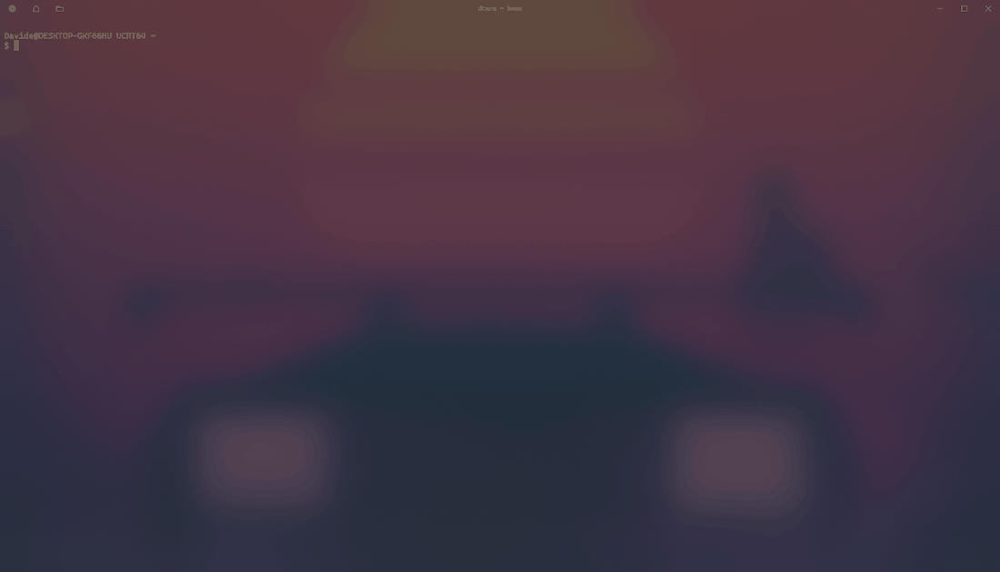

<div align="center">


<h1>D_term</h1>

<a href="https://github.com/Betadeimos/dterm/stargazers"></a>
<a href="https://github.com/Betadeimos/dterm/releases"></a>

<a href="LICENSE"></a>


<p><b>The 508 KB Native Terminal Orchestrator for AI Builders.</b><br>
<b>Run multiple Claude Code, Codex, OpenCode, PowerShell or Git Bash sessions side-by-side in an auto-grid — zero Electron, instant start, automatic session restore.</b></p>

<h3><a href="https://github.com/Betadeimos/dterm/releases/latest">Download dterm (508 KB .exe)</a></h3>

</div>



## Why dterm

- **The grid builds itself.** `Ctrl+Alt+T` splits the largest pane. Press it four times, get a 2x2.
- **Drag to resize.** Grab any gap between panes and pull. (Windows Terminal has had this
  [open since 2019](https://github.com/microsoft/terminal/issues/992).)
- **Grid or Tabs, same sessions.** `Ctrl+Alt+G` flips between them without touching a shell.
- **Your agents come back.** Close dterm, reopen it: every pane returns to its folder, and panes that
  ran a coding agent start it again: [Claude Code](https://claude.com/claude-code) resumes its newest
  conversation (`claude --resume <id>`), aider reloads its chat (`aider --restore-chat-history`), codex
  and opencode restart in the folder. A small `[claude]` / `[codex]` / `[opencode]` / `[aider]` tag
  marks the panes running one.
- **See which pane needs you.** A small dot before a pane's name (and its tab) is blue while it
  streams output, green when it is done, yellow when it waits for you. Agents that send OSC 9 / 777
  notifications and shells with OSC 133 prompt marks flip it at once; otherwise 4.5 s of quiet means
  done and a bell means waiting. Focusing the pane clears it.
- **Type once, into every pane.** `Ctrl+Alt+B` broadcasts keys and pastes to all panes, with a red
  frame and a note in the title bar while it is on. `Esc` stops it.
- **One key, one worktree.** `Ctrl+Alt+N` asks for a branch name, runs
  `git worktree add ../<repo>-<branch> -b <branch>` for the focused pane's repo (or reuses it), and
  opens a pane named after the branch in it.
- **Works out of the box.** Panes start in Windows PowerShell, which every Windows has. The settings
  page (`Ctrl+Alt+Comma`) switches new panes to PowerShell 7, Command Prompt or Git Bash, whichever
  are installed. PowerShell and Git Bash panes are named after their folder and come back in it.
- **Looks like Windows Terminal.** Acrylic that stays on when unfocused, One Half Dark, Cascadia Mono,
  emoji and symbol fallback, 5 themes (One Half Light among them).

Native Rust, Direct2D and DirectWrite, ConPTY. Panes run Windows PowerShell; the settings page
switches new panes to PowerShell 7, Command Prompt or Git Bash, whichever are installed.

### Why dterm vs. heavy agent IDEs?

| | dterm | Electron/WebGL agent IDEs |
|---|---|---|
| Install | ~508 KB single .exe | 200+ MB |
| RAM | ~15 MB | 500+ MB |
| Rendering | Pure Direct2D + ConPTY | Chromium + WebGL |
| Startup | Instant | Seconds |
| Workflow | Stays in your normal folders | Forced worktrees and accounts |

## Install

Download `dterm-vX.Y.Z.exe` (or the zip) from [Releases](https://github.com/Betadeimos/dterm/releases)
and run it. No installer: put it anywhere and pin it to the taskbar.

**Requires** Windows 10 1809+. [Git for Windows](https://gitforwindows.org/) is optional: it adds Git Bash
and the worktree shortcut. Windows 11 22H2+ uses the
system acrylic; Windows 10 gets dterm's own.

## Build from source

You need [Rust](https://rustup.rs/) (MSVC toolchain) and Visual Studio Build Tools with
"Desktop development with C++".

```
cargo build --release     # target\release\dterm.exe
cargo test                # unit tests
```

`.\release.ps1` builds `dist\dterm-vX.Y.Z.exe` and a zip; `-Publish` also tags and creates the GitHub
release (needs the GitHub CLI). Want to help? Read [CONTRIBUTING.md](CONTRIBUTING.md).

## Shortcuts

dterm's own shortcuts use Ctrl+Alt, so Ctrl+Shift combinations reach your shell and apps.
Rows marked * can be changed on the settings page. AltGr counts as Ctrl+Alt on many keyboards: when
AltGr+key types a character on your layout, that character wins, and left Ctrl + left Alt give the shortcut.

### Panes and layout

| Keys | Action |
| --- | --- |
| `Ctrl+Alt+T` * | Add a pane (splits the largest one) |
| `Ctrl+Alt+Plus` / `Ctrl+Alt+Minus` * | Split the focused pane right / below (also `Alt+Shift+Plus` / `Minus`) |
| `Ctrl+Alt+W` *, or `exit` | Close the pane |
| `Ctrl+Alt+R` * | Rename the focused pane |
| `Ctrl+Alt+Z` * | Zoom the focused pane to the whole window, and back |
| `Ctrl+Alt+G` * | Switch between Grid and Tabs (or the button, top-left) |
| `Ctrl+Alt+N` * | New pane in a git worktree: type a branch, Enter (`Esc` cancels) |
| `Ctrl+Alt+B` * | Broadcast input to every pane, and back (`Esc` also stops) |
| `Alt+Arrows` | Move focus (in tabs: Left / Right pick the previous / next tab) |
| `Alt+Shift+Arrows` | Resize the focused pane (grid) |
| `Ctrl+Alt+Arrows` | Swap the focused pane with its neighbor (grid) |
| `Ctrl+Tab` / `Ctrl+Shift+Tab` | Next / previous pane or tab |
| Drag a gap | Resize panes |

### Sessions and settings

| Keys | Action |
| --- | --- |
| `Ctrl+Alt+S` * | Save the session (over its file, or ask for a name the first time) |
| `Ctrl+Alt+H` * | Start page (also the ≡ button); the session keeps running |
| `Ctrl+Alt+Comma` * | Settings: theme, opacity, shell, every shortcut (keys or mouse: click, wheel, right-click resets a shortcut) |

### Text

| Keys | Action |
| --- | --- |
| Mouse drag, double / triple click | Select text (`Shift+drag` in apps that take the mouse, like vim, tmux, htop) |
| `Shift+Arrows`, `Ctrl+Shift+Left` / `Right` | Select by character / word |
| `Ctrl+C` (with a selection), right-click | Copy; right-click with no selection pastes |
| `Ctrl+V` / `Ctrl+Shift+V` | Paste as plain text |
| `Esc` | Drop the selection |
| Mouse wheel | Scroll history (apps that ask for the mouse get the wheel) |
| `Ctrl+Plus` / `Ctrl+Minus` / `Ctrl+0`, `Ctrl+wheel` | Font size |

## Sessions

Closing the window, or going to the start page, saves the layout, each pane's folder and name, the view and the
font size to `%APPDATA%\dterm\last.session`. `Ctrl+Alt+S` saves it under a name in
`%APPDATA%\dterm\sessions`, and from then on saves over that file. Closing the last pane with `exit` ends dterm
without saving.

When something is saved, dterm opens on a start page: last session, a saved one (with a layout preview), or a
new one. Arrows or mouse choose, Enter opens, `F2` renames, `Del` (twice) deletes.

Settings live in `%APPDATA%\dterm\settings`, a small text file you can also edit by hand.

## Status and roadmap

Early, but in daily use. Open work is in [GitHub issues](https://github.com/Betadeimos/dterm/issues); the history is in [ROADMAP.md](ROADMAP.md).

## License

[Apache-2.0](LICENSE)
